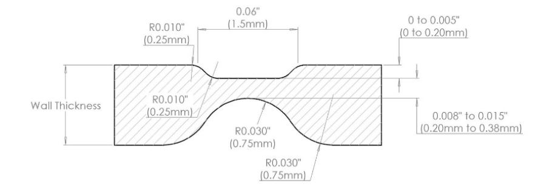
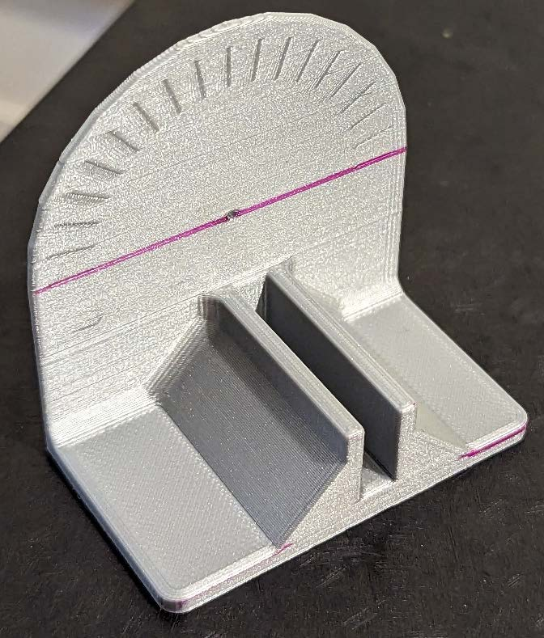
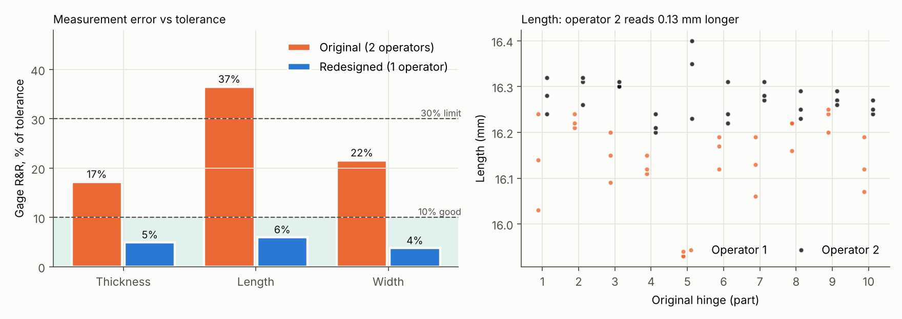
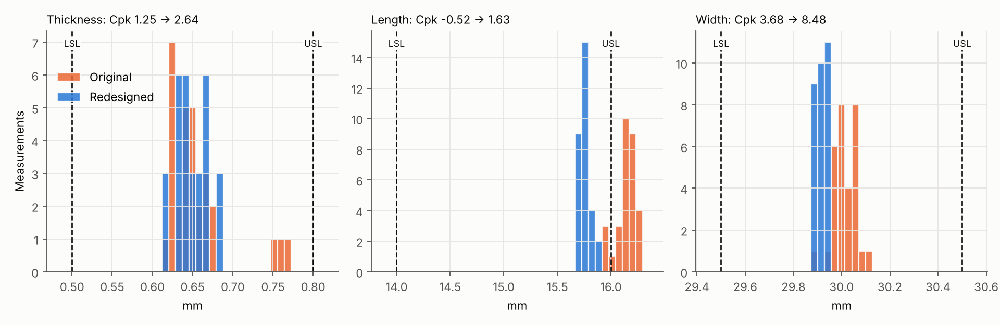
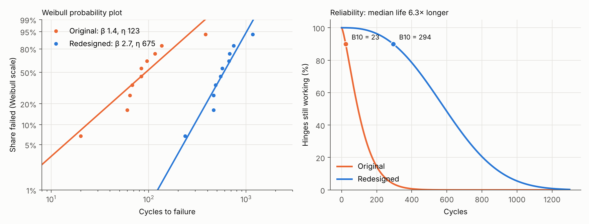
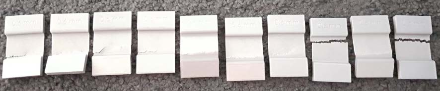
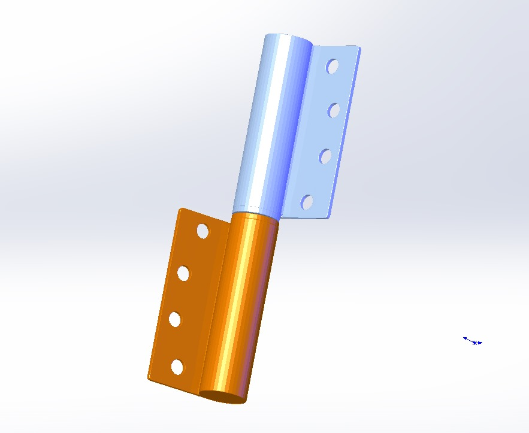

# 3D Printed Living Hinge: Quality and Reliability

Can a ship carry a 3D printer and print its own spare parts at sea? This project checks one common part, a PLA living hinge, from both sides: **is it made to spec** (measurement system and process capability) and **how long does it last** (life testing and Weibull analysis). Then it checks whether a reprint with better settings fixes both.

Done for Probability, Quality and Reliability (MCEN90059, University of Melbourne, 2023), part of my Master of Mechatronics Engineering. The full analysis runs in Python from the raw data.

| | |
|---|---|
|  |  |
| The hinge and its three critical dimensions | 3D printed jig used to cycle hinges to failure |

## Headline results

| | Original print | Reprint | |
|---|---|---|---|
| Length Cpk (one operator) | **−0.52** (94% out of spec) | **1.63** | now inside the spec |
| Thickness Cpk | 1.25 | 2.64 | |
| Median life | 94 cycles | **590 cycles** | 6.3× longer |
| B10 life (10% failed) | 23 cycles | **294 cycles** | 12.7× longer |
| Weibull shape β | 1.4 | 2.7 | fails more predictably |

The two designs have different life distributions (likelihood ratio test, p = 3.5 × 10⁻⁶).

**What changed in the reprint** (Prusa i3 MK3S, PLA, PrusaSlicer): layer height 0.15 → 0.12 mm, infill 15 → 20%, bridge speed 25 → 30 mm/s, all inside a 5 hour print budget.

## 1. Can we trust the measurements?

Before judging the parts, judge the gauge. Two operators measured 10 original hinges 3 times each with calipers. A crossed ANOVA Gage R&R (AIAG method) splits the spread into part to part variation, repeatability and operator differences.



- **Length was not measurable** with that method. Gage R&R used 37% of the tolerance (over the 30% limit), and operator 2 read longer than operator 1 on every single part, by **0.13 mm** on average. The hinge has no clean reference edge for length.
- Thickness (17%) and width (22%) were marginal.
- The reprint study used one operator, so it only shows repeatability (4 to 6% of tolerance). That's good, but it can't show operator differences.
- **Fix:** a CMM or a simple locating fixture, so the length reading doesn't depend on who holds the calipers.

## 2. Is the process capable?



To compare fairly, the original Cpk above uses operator 1 only, like the reprint. Length was the real problem: the original parts sat above the 16 mm upper limit. The reprint moved them back inside the spec and almost halved the spread. Full numbers with confidence intervals are in [`results/summary.json`](results/summary.json).

## 3. How long do they last?

Ten hinges of each design were cycled on the jig until they failed.



| | |
|---|---|
|  |  |
| Original: split, bent, cracked | Reprint |

- Every hinge ran to failure, so no data was censored or dropped, including the long lasting 384 cycle original.
- Weibull fits by maximum likelihood, with 95% confidence bounds from the profile likelihood (B10: 6 to 52 cycles original, 145 to 440 reprint).
- Weibull and lognormal fit about equally well (AIC); normal fits worst.
- Hinge dimensions don't predict life (all Spearman p > 0.3). The print settings matter, not small size differences.
- Cold days gave shorter lives. Temperature wasn't controlled, so it's a likely source of scatter.

The improved hinge then went into a new part design:



## Run it

```bash
pip install -r requirements.txt
cd analysis && python run_analysis.py      # writes results/summary.json and the figures
cd .. && python -m pytest -q               # checks the methods on synthetic data with known answers
```

## Repo layout

```
data/       raw measurements (Gage R&R, repeatability) and life test cycles
analysis/   quality.py (Gage R&R, Cp/Cpk), reliability.py (Weibull, censoring, LR tests), run_analysis.py
tests/      method checks against known answers
results/    summary.json
media/      figures and photos
```

## What I learned

- Check the gauge before you judge the process. Half of the length "problem" was the calipers.
- Small samples need confidence bounds. Ten hinges give a B10 anywhere from 6 to 52 cycles.
- Don't remove data that doesn't fit. The longest lasting hinge was real.
- Keep test conditions fixed. Temperature and how hard each operator pushed the jig both added scatter.
